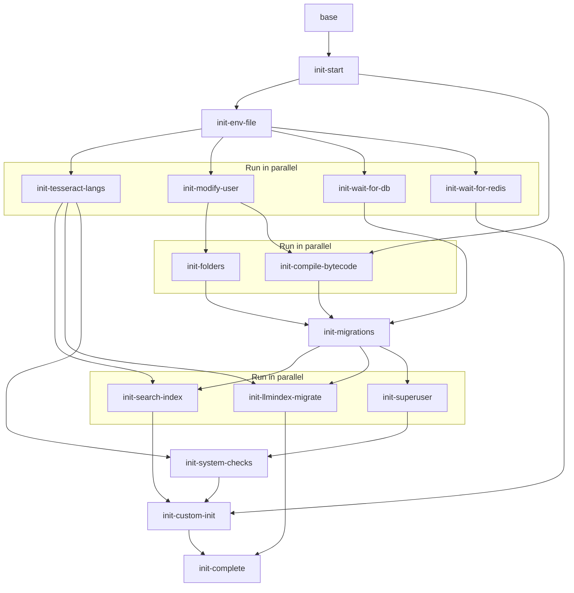

# Container init flow

Startup order of the s6-rc oneshot services under `docker/rootfs/etc/s6-overlay/s6-rc.d/`. An arrow `A --> B` means B lists A in its `dependencies.d/`, so B waits for A. Redundant (transitive) edges are omitted.

Each labelled box is a group of services that can run in parallel: every service in it starts as soon as its own dependencies finish, so services in the same box run in parallel. A service does not wait for the rest of its group, only for the arrows pointing at it. Long-running services such as `init-tesseract-langs` (package installs) overlap with several later steps.

`init-search-index` and `init-llmindex-migrate` run `manage.py`, which runs the Django system checks, including the check that the configured OCR languages are installed, so they wait for `init-tesseract-langs`.
